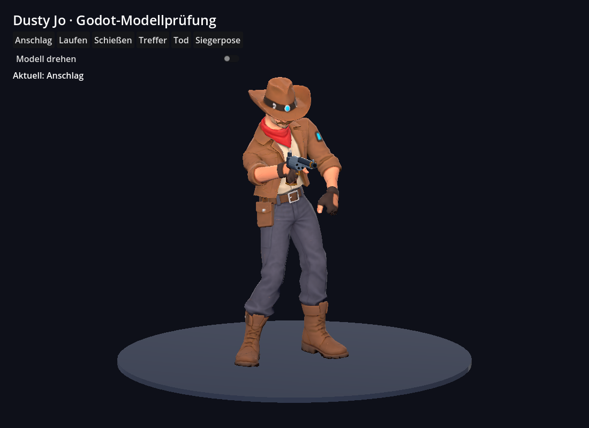

# Dusty Jo – GLB-Test für Claude

Erster vollständiger Testheld mit starrem Revolver und `Idle`, `Run`, `Shoot`, `Hit`, `Death`, `Victory`. In Godot 4.5.1 importiert und geprüft. Der Test im eigentlichen Spiel folgt durch Claude.

- [GLB-Modell](dusty_jo.glb)
- [Vollständiges ZIP mit Godot-Testprojekt, Blender-Quelle und Vorschauen](Dusty_Jo_Godot_Testpaket.zip)
- [Einbauhinweise für Claude](README_FUER_CLAUDE.md)
- [Lizenz und Herkunft](LIZENZ_UND_HERKUNFT.md)

Das ZIP enthält die komplette Ablage einschließlich `Quellen/dusty_jo_bearbeitbar.blend` und aller Animationsansichten. Die daneben abgelegten Dateien erlauben bereits einen schnellen Godot-Test.

Wichtig: Im GLB heißen die Knochen exakt `mixamorig:RightHand` usw. Godot importiert diese als `mixamorig_RightHand`. Die Zuordnung ist dokumentiert. `WeaponSocket`, `Weapon`, `Muzzle` bleiben unverändert. Für diesen Arbeitsschritt wurden keine kostenpflichtigen Adobe-Funktionen verwendet.

