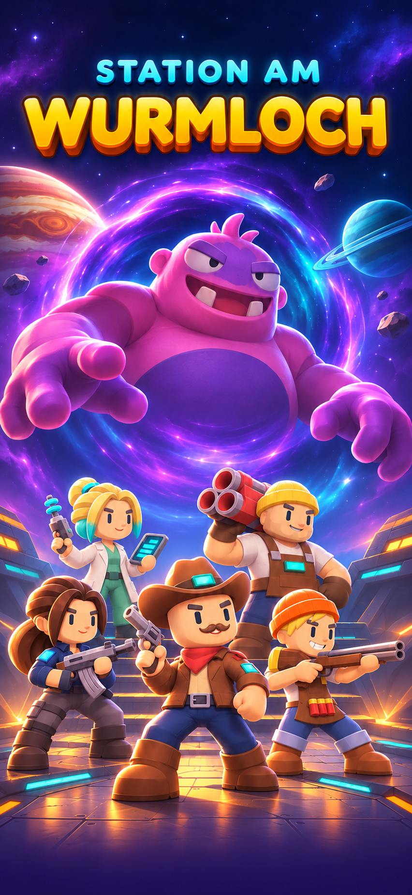

# Start- und Ladebild – Comic-Fassung 2

Vom Nutzer zum Hochladen ausgewählt: die zuletzt gezeigte Fassung mit weniger leerem Boden und tiefer platzierter Heldengruppe. Frühere Entwürfe bleiben erhalten.

## Datei

- `ladebildschirm_comic.png`: statisches PNG, 852 × 1846 Pixel, 2.125.196 Byte.
- Titel „STATION AM WURMLOCH“ ist Bestandteil des Bildes.
- Fünf aktuelle Helden: Dusty Jo, Iska mit dunkelbraunen Haaren, Brocken mit gelber Mütze, Volta mit türkisfarbenen Haarspitzen und Fritzi mit orangefarbener Mütze sowie bestätigter Anschlagpose.
- Boss: Wurmloch-Zombie-Koloss aus der bestehenden Gegnerübersicht, als große Comic-Posterfigur umgesetzt.
- Hintergrund: Wurmloch, Planeten und Space-Brücke mit höherem Detailgrad und Lichtwirkung als die eigentlichen Spielfiguren.

## Einbau durch Claude

Als statischen Hintergrund des Start-/Ladebildschirms verwenden. Gleichmäßig skalieren, nicht verzerren. Bei anderen Bildschirmverhältnissen Titel, Gesichter und Stiefel vollständig sichtbar halten.

Der Ladebalken und der tatsächliche Prozenttext werden separat in Godot eingeblendet. Im PNG sind absichtlich keine feste Prozentzahl und kein falscher Fortschrittsbalken eingebrannt. Dafür den schmalen ruhigen unteren Rand nutzen; als Startpunkt bei diesem Bild etwa 94–95 % der Höhe für den Balken und 97 % für eine kurze Statuszeile, jeweils an die sicheren Bildschirmränder anpassen.

Eine Animation der Illustration ist für diese Fassung nicht erforderlich. Alle spielbezogenen Ladeinformationen bleiben echte Bedienelemente bzw. Texte. Das Bild ist ein neuer visueller Entwurf; bestehende Startbilder werden durch diese Ablage nicht gelöscht.

Mit integrierter Bildgenerierung aus der gelieferten Startbild-, Helden- und Gegnerreferenz erstellt. Die ursprüngliche Bildanweisung und der anschließende Korrekturauftrag liegen daneben. PNG-Lesbarkeit, Abmessungen und Prüfsummen sind in `DATEIPRUEFUNG.json` dokumentiert.
