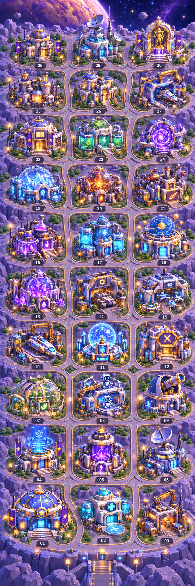

# Raumbasis: verbundene Wege bis Gebäude 30

Die bestehende Basis wurde um ein zusammenhängendes Wegenetz ergänzt. Gebäude, feste Plätze und bisheriger Stil bleiben die Grundlage. Vom Eingang führen zwei Längswege mit Querwegen und individuellen Zugängen durch das Lager; mit dem Ausbau entstehen Rundwege.

- [Hinweise für Claude: Freischaltung, Ebenen und Zoom](README_FUER_CLAUDE.md)
- [Einzelne Wegverbindungen und Freischaltschwellen](WEGENETZ.json)
- [Prüfung aller 30 Ausbaustufen](WEGENETZ_PRUEFBERICHT.json)
- [Komplettes Daten- und Bildpaket](Raumbasis_Wege_v1.zip)

Die Grafik ist eine Gesamtvorschau mit 724 × 2172 Pixeln. Für den tatsächlichen stufenweisen Ausbau Gebäude und Wege getrennt aufbauen. Alle 30 Ausbaustufen sind im logischen Verbindungsplan vom Eingang erreichbar. Kameraübersicht, Verschieben und Gebäude-Fokus sind für Claude beschrieben; die vorhandene Spielszene wurde durch diese Ablage nicht geändert.
