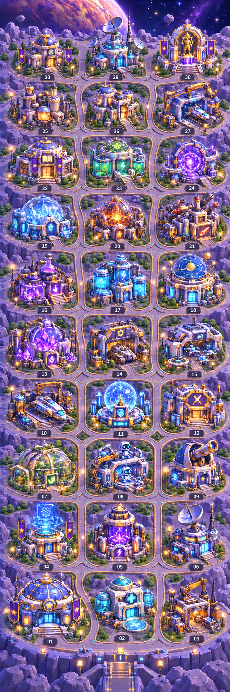

# Bestehende Raumbasis: Wege zwischen Gebäude 01–30

Der Nutzer hat die Wege-Vorschau bestätigt und den Upload nach GitHub beauftragt. Die Gebäude und die Anordnung stammen aus der bestehenden Basis. Geändert wurden die verbindenden Wege und unmittelbar angrenzender Boden; die bisherigen Dateien unter `Vorlage_Raw/Raumbasis_30` bleiben erhalten.

## Vorhandene Plätze erhalten

Die Basis wächst wie bisher von unten nach oben mit drei Gebäuden je Reihe. Die 30 Gebäudeplätze, IDs, ungefähren Fußpunkte und Auswahlrechtecke in `GEBAEUDE_INDEX_ORIGINAL.json` wurden unverändert übernommen. Die PNG-Vorschau ist eine mit der integrierten Bildgenerierung bearbeitete Illustration, keine pixelgenaue Ebenendatei. Sie dient als Gestaltungsvorlage für das Wegenetz, nicht als Ersatz der vorhandenen einzelnen Gebäuderessourcen.

## Zusammenhängendes Lager statt einzelner Stellplätze

- Ein Zugang führt von der vorhandenen unteren Brücke zur ersten Reihe.
- Zwei Längswege laufen durch die Zwischenräume der drei Gebäudespalten.
- Querwege vor den Reihen verbinden beide Seiten. Mit vollständig freigeschalteten Reihen entstehen Rundwege und alternative Verbindungen.
- Kurze Zugänge schließen alle 30 Gebäude an; die Hauptwege bleiben etwas breiter.
- Je zwei Reihen bilden einen lesbaren Ausbaubereich: 01–06, 07–12, 13–18, 19–24, 25–30.
- Violettgraue Bodenplatten, zurückhaltende Goldkanten und wenige türkisfarbene Randlichter passen zum vorhandenen Lager. Die Gebäude bleiben optisch wichtiger als die Wege.

## Daten und stufenweise Freischaltung

`WEGENETZ.json` enthält 61 Punkte und 69 zusammenhängende Wegabschnitte. Ursprung oben links, Koordinaten in Pixeln der bestehenden Vorlage mit 724 × 2172 Pixeln. Die Gebäudepositionen kommen aus dem vorhandenen Index, die Wegkoordinaten sind ein zusätzlicher logischer Anschlussplan. Eingangstreppen, Kurven und Kanten beim Einbau an den tatsächlichen Sprites fein ausrichten; dies ist kein fertiges Kollisions- oder Navigationsnetz.

Bei `champion_count = N`:

1. Gebäude mit `unlock_at <= N` anzeigen.
2. Wegabschnitte mit `unlock_at <= N` anzeigen.
3. Alle anderen Gebäude und Wege ausblenden. Höchstens das nächste Ausbauziel als separate Vorschau zeigen.
4. Bereits platzierte Gebäude beim Zuwachs weder umsortieren noch verkleinern. Nur die neue Verbindung und das neue Gebäude einblenden.

Die linke Verbindung zur nächsten Reihe wächst mit deren erstem Gebäude. Die mittlere Verbindung wächst mit dem zweiten. Der rechte Ast schließt bei vollständiger Reihe den Rundweg. Damit entstehen keine isolierten Straßenstücke zu noch gesperrten Gebäuden.

Alle 30 Ausbaustufen von 1 bis 30 wurden auf Erreichbarkeit vom Eingang geprüft. Kein aktives Gebäude fehlt, kein gesperrtes Gebäude wird angeschlossen und kein aktiver Wegabschnitt liegt isoliert. Die Ergebnisse stehen in `WEGENETZ_PRUEFBERICHT.json`.

## Umsetzung in Godot

Die vorhandenen Gebäudesprites weiterverwenden. Boden, Wege und Gebäude als getrennte Ebenen anlegen; Wege unter die Gebäude und deren Eingangstreppen legen. Die Punkte können als Grundlage für `Path2D` / `Curve2D`, `Line2D` oder die Platzierung passender Weggrafiken dienen. An Kreuzungen Anschlüsse bündig verbinden und dekorative Lichtpunkte sparsam setzen. Eine `Curve2D` bei Bedarf abtasten, bevor sie als Weglinie oder Kantenverlauf verwendet wird.

Die Ganzbild-Vorschau zeigt den Vollausbau. Sie nicht schon bei fünf Champions unverändert als Spielhintergrund einsetzen, sonst sind alle zukünftigen Gebäude sichtbar. Es werden keine 30 unterschiedlichen vollständigen Hintergrundbilder benötigt: Der stabile Plan wird über die Freischaltschwellen aufgebaut.

Die ursprüngliche Gebäudevorlage ist undurchsichtig und enthält Boden sowie Nummernschilder. Falls Gebäude noch als rechteckige Ausschnitte vorliegen, zuerst echte Konturen freistellen. Sonst würden die Ausschnittflächen neue Wege verdecken. Die Kontrollnummern sind nur zur Planung und gehören nicht in fertige Gebäudesprites.

## Kompakte Übersicht und Zoom

Eine kompakte Gesamtansicht der aktiven Basis und ein Gebäude-Fokus sind vorgesehen. Herauszoomen löst die Übersicht, ohne dass die bestehenden Plätze neu angeordnet werden müssen.

- **Übersicht:** Begrenzung aller freigeschalteten Gebäude samt Eingang mit etwas Rand in den tatsächlich freien Bildschirmbereich einpassen. HUD-Flächen dabei abziehen.
- **Lageransicht:** Auf die Lagerbreite einpassen. Bei größeren Ausbaustufen lässt sich der Ausschnitt etwas nach oben verschieben.
- **Gebäude-Fokus:** Auf ein angetipptes Gebäude samt Dach, Antenne und Umgebung zoomen; eine Übersicht-Aktion führt sofort zurück.
- Zwei-Finger-Zoom am Fingerpunkt zentrieren. Verschieben an den aktiven Lagergrenzen begrenzen, statt in leere Flächen zu scrollen.
- Namen und Detailwerte erst im Fokus anzeigen; bei kleiner Übersicht klare Symbole / Gebäudeformen nutzen. Antippflächen auf dem Bildschirm ausreichend groß halten.
- Das ursprüngliche 724 × 2172-Bild passt bei einem freien Feld von beispielsweise 390 × 620 Pixeln mit etwa 26–27 % Maßstab vollständig hinein, einschließlich eines kleinen Rands. Die tatsächliche Skalierung aus der verfügbaren Fläche berechnen, nicht fest vorgeben.

Die schematische zoombare Planungsansicht im Chat zeigt genau diese Freischaltlogik. Sie ersetzt die endgültige Spielszene nicht. Im Browser geprüft: Ausbauzahl 5 und 30, aktive Wege, Auswahl eines einzelnen Gebäudes sowie Hinein-/Herauszoomen. Es wurde kein bestehender Spielcode geändert.

## Lieferumfang

- `raumbasis_mit_wegen_vorschau.png`: bestätigte grafische Gesamtvorschau.
- `GEBAEUDE_INDEX_ORIGINAL.json`: bestehende Gebäudeplätze unverändert.
- `WEGENETZ.json`: einzelne Wegverbindungen und Freischaltschwellen.
- `WEGENETZ_PRUEFBERICHT.json`: logische Erreichbarkeit aller 30 Ausbaustufen.
- `BILDANWEISUNG.txt`: vollständige Bildanweisung für die integrierte Bildgenerierung.
- `wegenetz_erstellen.py`: reproduzierbare Erstellung und Prüfung der Verbindungsdaten.

Die Erweiterung oberhalb von 30 bleibt möglich: zusätzliche Dreierreihen und beide Längswege nach oben fortsetzen, vorhandene Plätze beibehalten.
